<div align="center">

# junban

**いま、誰の番？**<br>
Claude Code・Codex CLI・Gemini CLI などのコーディングエージェントを何本も動かすときに、どれが返事を待っているかをタブに出す tmux プラグイン。

[English](README.md) · [日本語](README.ja.md) · [▶ 25秒のデモ](https://junban.namelessjp.com/)

<a href="https://junban.namelessjp.com/"></a>

</div>

複数の AI エージェントを動かしていると、1つが20分も `psql` の実行許可を待っていた、ということが起きます。ウィンドウを1つずつ開くまで気づけません。

**junban（順番）** は、どのエージェントが返事を待っているかを tmux のタブに印で示し、次に押すキーをステータスバーに出します。

- **✋ 赤**：あなたの返事待ち（許可・質問）
- **✓ 緑**：作業が終わり、まだ見ていない
- **● 黄**：作業中

**Alt+a** を押すと、次に見るべきウィンドウへ移動します（返事待ちが先、次に完了。それぞれ待たせた時間が長い順）。

## 導入

ターミナルで1行実行します。

```sh
curl -fsSL https://raw.githubusercontent.com/Nameless-LLC/junban/main/install.sh | bash
```

junban を `~/.tmux/plugins/junban` に置いて tmux.conf に1行追記し、Claude Code が入っていれば連携も設定します。

<details>
<summary>tmux のプラグイン管理ツール（TPM）で入れる場合</summary>

`~/.tmux.conf` に追記して、`prefix I` を押します。

```tmux
set -g @plugin 'Nameless-LLC/junban'
```

続けて Claude Code と連携します。

```sh
claude plugin marketplace add Nameless-LLC/junban && claude plugin install junban@junban
```

</details>

Codex CLI と Gemini CLI は `~/.tmux/plugins/junban/scripts/setup.sh codex`（または `gemini`）を実行します。詳しくは[Claude Code 以外のエージェント](#claude-code-以外のエージェント)を見てください。

tmux 3.2 以上、bash、git が必要です。python3 があれば、次の機能が使えます。

- Esc で止めたときの印の自動修正
- ウィンドウ名の自動設定
- 1行要約と変更内容の表示
- タイムライン
- 放置ウィンドウの `z`
- Alt+n で起動する Claude Code を別の worktree に分ける機能

Codex CLI と Gemini CLI の設定（setup.sh）にも python3 が要ります。fzf があれば、Alt+f の一覧が返事待ち・完了の順に並び、文字を打って絞り込めます（なければ tmux 標準のウィンドウ一覧になります）。

### アップデート

junban は自動で更新されます。1日に1回、最新のリリース（Linux と macOS のテストを通った版）があれば更新して読み込み直し、Claude Code のプラグインも更新します。Claude Code 側は、新しく起動したセッションから新しい版になります。手元のファイルを変更している場合や、版を固定している場合は更新しません。すぐ更新したいときは、Alt+, →「今すぐアップデート」を選びます。Alt+, →「アップデート」で、main のすべての変更を追うか、更新しないかを選べます（`@junban-update stable | main | off`）。0.7.0 より前の版は、一度だけ手で更新してください。

```sh
git -C ~/.tmux/plugins/junban pull && claude plugin update junban@junban
```

### うまく動かないとき

`~/.tmux/plugins/junban/scripts/doctor.sh` を実行してください（Claude Code なら `/junban:doctor`）。よくある問題なら直し方まで表示します。直らなければ、その出力を[バグ報告](https://github.com/Nameless-LLC/junban/issues/new?template=bug.yml)に貼ってください。ウィンドウの名前や依頼の内容は出力に含まれません。質問は [Discussions](https://github.com/Nameless-LLC/junban/discussions) へ。セキュリティの問題は公開せずに報告してください（[SECURITY.md](SECURITY.md)）。

## 覚えるキーは1つだけ

**Alt+a** です。標準では、ステータスバーの一番下の行によく使うキーが出ます。返事待ちや未確認の完了があると、その上の行に「Alt+a で移動」「Alt+a で確認」と出ます。

| キー | 動作 |
|---|---|
| **Alt+a** | 次に見るべきウィンドウへ移動。返事待ちが先、次に完了。それぞれ待たせた時間が長い順 |
| **Alt+f** | 全エージェントの一覧（並び順は Alt+a と同じ）。文字を打つと絞り込める。画面のプレビュー付き |
| **Alt+n** | 今のディレクトリで新しいエージェントを起動（同じリポジトリでほかのエージェントが作業中なら、Claude Code は別の worktree で起動） |
| **Alt+,** | 設定。Alt+n で起動するもの・言語・ステータス行の数など。`~/.config/junban/settings.conf` に保存 |
| **Alt+/** | キーの一覧。今日のタイムラインと待ち時間の集計も出る |
| `prefix T` | 今日のタイムライン。ウィンドウごとに、作業中・返事待ち・完了の時間帯を1行で表示 |
| Alt+1…9 · Alt+[ ] · Alt+Tab · Alt+z · Alt+w | その番号のウィンドウへ · 前／次 · 直前 · 最大化 · 閉じる（確認あり） |

端末が Alt キーを tmux に送らない場合は、prefix の後に `a`（Alt+a）、`f`（Alt+f）、`C`（Alt+n）、`/`（Alt+/）を押します。`prefix g` で作業用のシェルを開けます。

すべての設定項目は[マニュアル](https://junban.namelessjp.com/manual/)にあります。

## 主な機能

タブに印を出すプラグインは[多く](#先行事例)あり、待たせた順に移動するもの（[tmux-agent-status (gs)](https://github.com/gs/tmux-agent-status)）や待ち時間を測るもの（[muxa](https://github.com/Open330/muxa)）もあります（[比較表](https://junban.namelessjp.com/#compare)）。junban は、これらを常駐プロセスなしの tmux プラグイン1つで使えるようにしました。ステータスバーに次に押すキーを出す機能と、放置したウィンドウを一覧の下に移す機能は、どちらもほかのツールには見つかりませんでした。

**「作業中」のまま残りません。** 途中で Esc を押すと Claude Code は終了を知らせないため、フックだけで状態を見るツールでは「作業中」のまま残ります。junban は Claude Code のセッション記録（`~/.claude/sessions`）を見て、正しい印に直します。プロセスの親子関係もたどって、そのウィンドウのエージェントかどうかを確かめます。

**ウィンドウ名は作業内容から自動で付きます。** 標準では依頼の1行目が名前になります。`@junban-rename llm` と LLM の接続先を設定すると（[設定](#設定)の例を参照）、直近の依頼をまとめた名前にします（ローカルの小さいモデルで十分です）。「OK」「進めて」のような短い返事では変わらず、自分で付けた名前（`prefix ,`）も上書きしません。

**Alt+n で開いたウィンドウは、起動中であることが分かります。** エージェントが立ち上がるまで、新しいウィンドウではスピナーが回り、タブには薄い ◌ が付きます。

**VS Code では、今のターミナルの表示を差し替えません。** VS Code のウィンドウごとにターミナルを別々の tmux セッションにつないでいる場合、Alt+a や Alt+f で別のセッションのエージェントへ移動すると、今のターミナルの表示は変えず、そのエージェントを表示している VS Code のウィンドウを前面に出します（そのウィンドウがなければ、そのプロジェクトのフォルダを開きます）。今のターミナルで切り替えたいときは `set -g @junban-vscode-raise off` を書きます。

**放置したウィンドウは下へ移ります。** 1日以上触っていないウィンドウには `z` が付き、Alt+f の一覧の下に移ります。放置したウィンドウが多くても、返事を待っているものを見失いません。

**何を求めているか、何が終わったかを1行で出します。** エージェントが質問・許可を求めたときや作業を終えたときに、その内容を1行でステータスバーと Alt+f の一覧に出します（例:「テスト成功、PR #12 を作成」）。作業を終えたときの1行は、LLM を設定していれば LLM がまとめ、なければエージェントの最後の発言から最初の1文を使います。質問や許可を求めたときは、その内容をそのまま出します。`@junban-notify-cmd` で通知を設定していれば、完了の通知にも同じ1行が入ります。ntfy.sh などを使えばスマホにも送れます（ntfy.sh の公開トピックは、名前を知っている人なら誰でも読めます）。1行要約を出さないときは `set -g @junban-recap off` を書きます。

作業を終えたときは、変わったもの（`3ファイル +41 −88 · 2コミット · PR #12`）も出ます。Alt+f の一覧では、プレビューの先頭に変更したファイルの一覧が出て、Ctrl+o で PR を開けます。

**完了の知らせはまとめて受け取れます。** `set -g @junban-done-batch 30` にすると、完了（✓）は毎時0分と30分にまとめて知らせ、それまではステータスバーに件数だけが出ます。`@junban-notify-cmd` で通知を設定していれば、通知も1通にまとめて届きます。返事待ち（✋）はすぐに届きます。

**待ち時間を測ります。** ステータスバーに、今日エージェントを待たせた合計と、返答の中央値が出ます（`今日の待ち時間 42分 · 返答の中央値 3分10秒`）。Alt+/ では、直近7日の棒グラフ、先週との比較、返答の中央値が最も短かった日（自己ベスト）、返答の中央値が目標（標準5分）以内だった日の連続記録、今日のウィンドウ別の待ち時間（長い順）が見られます。`scripts/stats.sh 30` で直近30日分を表示します。待ち時間は ✋ や ✓ が付いてから、返事をするかウィンドウを開くまでです。見ている最中に終わった分は数えず、1回あたり最大1時間で打ち切ります。記録は自分の PC の TSV ファイルにだけ残ります。

**1日のタイムラインが見られます。** `prefix T` を押すと、ウィンドウごとに1行ずつ帯が並びます（Alt+/ にも出ます）。黄色の █ が作業中、赤の ▓ が返事待ち、緑の ▒ が完了・未確認です。下には、稼働していた時間帯、作業時間、待たせた時間、同時に動いたウィンドウの最大数が出ます。`scripts/timeline.sh 1` で前日を表示します。Alt キーで開きたい場合は `set -g @junban-key-timeline M-y` を書きます（Claude Code では Alt+t が思考の切り替えなので、標準では割り当てていません）。

**マスコットがいます。** ステータスバーに、状況に合わせて表情が変わるマスコットが出ます。返事待ちがあれば `[▮ ▮]!`、終わったら `[◠ ◠]`、作業中は `[▮▮ ]`、何もないときは `[▬ ▬]z` です。`set -g @junban-mascot off` で消せます。

**英語・日本語・タイ語に対応しています。** 環境変数 `LC_ALL`・`LC_MESSAGES`・`LANG` の順に見て切り替わります。固定したいときは `set -g @junban-lang ja` を書きます。日本語やタイ語のウィンドウ名も表示幅で切り詰めるので、タブの幅が崩れません。

**tmux と bash で動きます。** 一部の機能は python3 を使います。常駐プロセスはありません。テストは Linux と macOS の CI で実行しています。

## 設定

すべて任意です。`~/.tmux.conf` で、プラグインを読み込む行より**前に**書いてください。よく使う項目は **Alt+,** でも変えられ、`~/.config/junban/settings.conf` に保存されます。Alt+, で選んだ値は、プラグインを読み込む行より前に書いた同じ設定より優先されます。読み込む行より後ろに書いた設定は次の起動でこの値を上書きするので、Alt+, がその行を示し、無効にするかを尋ねます。

日本語の表示に固定したい場合は、次の1行を書きます。

```tmux
set -g @junban-lang ja
```

ウィンドウ名をローカルの LLM に付けさせる場合は、次のように書きます。

```tmux
set -g @junban-rename llm
set -g @junban-namer-url http://localhost:11434
set -g @junban-namer-model qwen3:8b
```

## Claude Code 以外のエージェント

| エージェント | 導入 | できること |
|---|---|---|
| Claude Code | プラグイン（上の1行で入ります） | ✋ ✓ ●、1行要約、変更内容、ウィンドウの名前。Esc で止めても印が自動で直る |
| Codex CLI | `scripts/setup.sh codex` のあと、Codex で `/hooks` を開いて一度だけ承認する | ✋ ✓ ●、1行要約（実行したいコマンドも含む）、変更内容、ウィンドウの名前。Esc で印が消える |
| Gemini CLI | `scripts/setup.sh gemini` | ✋ ✓ ●、1行要約（実行したいコマンドも含む）、変更内容、ウィンドウの名前 |

```sh
~/.tmux/plugins/junban/scripts/setup.sh codex    # ~/.codex/hooks.json に書く
~/.tmux/plugins/junban/scripts/setup.sh gemini   # ~/.gemini/settings.json に書く
```

どちらも既存のフックは残し、junban の分だけを入れ替えます（何度実行しても大丈夫です）。元のファイルは `.bak` に残ります。`--print` を付けると、書き込まずに内容だけ表示します。`set -g @junban-agent-cmd codex` にすると Alt+n で Codex が起動します。

ほかのツールも、そのツールが動いている tmux のペインの中からコマンドを実行できれば、junban につなげられます。次の1行で状態を知らせるだけです。

```sh
~/.tmux/plugins/junban/scripts/state.sh running   # ほかに waiting | done | idle | clear
```

## 先行事例

機能が重なるツールです。用途によってはこちらの方が合うかもしれません。
[tmux-agent-indicator](https://github.com/accessd/tmux-agent-indicator) ·
[tmux-agent-status (RatulMaharaj)](https://github.com/RatulMaharaj/tmux-agent-status) ·
[tmux-agent-status (rorhcdream)](https://github.com/rorhcdream/tmux-agent-status)（セッション記録がフックより確かだと示したのはこのプロジェクトです） ·
[tmux-handlr](https://github.com/CRThaze/tmux-handlr) ·
[claude-code-tmux-status](https://github.com/XavierYounan/claude-code-tmux-status) ·
[tmux-window-notifier](https://github.com/mrf/tmux-window-notifier) ·
[tmux-agent-status (gs)](https://github.com/gs/tmux-agent-status) ·
[muxa](https://github.com/Open330/muxa)

MIT ライセンス。開発元の [Nameless](https://namelessjp.com) で毎日使っています。
