<div align="center">

# junban

**Whose turn is it?**<br>
A tmux plugin that shows which of your AI coding agents (Claude Code, Codex CLI, Gemini CLI) is waiting on you.

[English](README.md) · [日本語](README.ja.md) · [▶ 25-second demo](https://junban.namelessjp.com/)

<a href="https://junban.namelessjp.com/"></a>

</div>

Your agents work in parallel. Somewhere, one has been waiting twenty minutes for you to approve a `psql` command. You only find out by opening every window.

**junban** (順番, Japanese for "turn," as in "whose turn is it?") badges every tab with its agent's state and tells you what to press next.

- **✋ red**: an agent is waiting on you (permission or question)
- **✓ green**: it finished and you haven't looked yet
- **● yellow**: it is working

Press **Alt+a** to jump to the agent that needs you most: ✋ before ✓, longest wait first.

## Install

One line in a terminal:

```sh
curl -fsSL https://raw.githubusercontent.com/Nameless-LLC/junban/main/install.sh | bash
```

It clones junban to `~/.tmux/plugins/junban`, adds one line to your tmux.conf, and connects Claude Code if you have it.

<details>
<summary>With TPM (the tmux plugin manager) instead</summary>

Add this line to `~/.tmux.conf` and press `prefix I`:

```tmux
set -g @plugin 'Nameless-LLC/junban'
```

Then connect Claude Code:

```sh
claude plugin marketplace add Nameless-LLC/junban && claude plugin install junban@junban
```

</details>

Codex CLI or Gemini CLI: run `~/.tmux/plugins/junban/scripts/setup.sh codex` (or `gemini`); Codex then asks you to trust the hooks once with `/hooks`. See [Supported agents](#supported-agents).

Requires tmux 3.2 or newer, bash, and git. Optional:

- **Python 3**, for badge repair after Esc, window names, recaps, the "what changed" summary, idle-window marks, the orange mark on silent agents, restoring windows after a restart, the timeline, Codex/Gemini setup, and the Alt+n worktree check.
- **fzf**, for the sorted, searchable Alt+f list. Without it, Alt+f opens tmux's own window chooser.

### Updates

junban updates itself. Once a day it moves to the newest release (a version that passed CI on Linux and macOS), reloads, and updates the Claude Code plugin; new Claude Code sessions use the new hooks. It never touches a checkout with local changes or one you pinned. To update right away, use Alt+, → Update now. To follow every commit on main, or to turn updates off, use Alt+, → Updates (`@junban-update stable | main | off`). Installs older than 0.7.0 need one last manual update: `git -C ~/.tmux/plugins/junban pull && claude plugin update junban@junban`.

### Something wrong?

Run `~/.tmux/plugins/junban/scripts/doctor.sh` (or `/junban:doctor` in Claude Code). It names the fix for the usual problems; if it doesn't, paste its output into a [bug report](https://github.com/Nameless-LLC/junban/issues/new?template=bug.yml) (the output leaves out window names and prompts). Questions go to [Discussions](https://github.com/Nameless-LLC/junban/discussions). Please report security issues privately; see [SECURITY.md](SECURITY.md).

## The only key you need

**Alt+a.** By default, the last row of the status line lists the keys worth knowing. When an agent is waiting, the row above it shows a banner pointing at Alt+a.

| Key | What it does |
|---|---|
| **Alt+a** | Jump to the agent that needs you: waiting before finished, longest first |
| **Alt+f** | Every agent in one list, neediest first, searchable, with a live preview |
| **Alt+n** | New agent window in the current directory (Claude Code starts in its own worktree if another agent already works in that repo) |
| **Alt+,** | Settings: what Alt+n starts, language, status rows, and more. Saved to `~/.config/junban/settings.conf` |
| **Alt+/** | Cheat sheet, generated from your actual bindings, with today's timeline and the wait report |
| `prefix T` | Today's timeline: a row per window, when each agent worked, waited on you, or finished |
| Alt+1…9 · Alt+[ ] · Alt+Tab · Alt+z · Alt+w | Go to window · prev/next · last · zoom · close (asks first) |

Terminal doesn't send Alt? The main actions also work after the prefix: `prefix a` (jump), `f` (list), `C` (new agent), `/` (cheat sheet), `T` (timeline). `prefix g` opens a scratch shell.

The full manual, with every option: [junban.namelessjp.com/manual](https://junban.namelessjp.com/manual/).

## What you get

Plenty of [plugins](#prior-art) badge your tabs, and a couple also jump to the longest wait ([tmux-agent-status by gs](https://github.com/gs/tmux-agent-status)) or measure waiting ([muxa](https://github.com/Open330/muxa)); the [comparison](https://junban.namelessjp.com/#compare) lines them up. junban does those in one tmux plugin with no daemon, and adds two things we didn't find elsewhere: a status line that shows your next key, and idle windows that move out of the way.

**Badges don't get stuck.** Press Esc mid-task and Claude Code sends no "stop" event, so tools that rely only on hooks show "working" forever. junban checks Claude Code's own session records (`~/.claude/sessions`) and walks the process tree to match each session to its pane.

**Windows are named after the task.** By default a window takes the first line of your latest prompt. To have a model name windows from your last few prompts instead, set `@junban-rename llm`, point `@junban-namer-url` at a model server, and set `@junban-namer-model` to one of its models (a small local model is enough). Short replies like "ok" or "yes" never rename a window, and a name you set yourself (`prefix ,`) is never changed.

**Alt+n never looks frozen.** The status line shows a spinner until the agent draws its first screen, and the tab shows a dim ◌ until the agent reports in (or a minute passes).

**Idle windows move out of the way.** Windows with no agent activity for a day get a dim `z` and move to the bottom of the Alt+f list, so the one that needs you never gets lost among dozens of idle ones.

**An agent that may be stuck turns orange.** A command that never returns or a network call that hangs leaves the tab on ●, looking just like an agent that is still working. When 15 minutes pass without a tool call finishing, its ● turns orange and shows how long it has been quiet (`● 23m`). The mark clears when the next tool call finishes or the agent stops working. The status line counts these agents, and they come first among the working ones in the Alt+f list. If you set `@junban-notify-cmd`, you get one notification when the mark appears. A long build, a long test run, or a long reply with no tool call gets the mark too, so look before you stop anything. Change the minutes, or turn it off, with Alt+, → Mark silent agents (`@junban-quiet-minutes`, 0 = off).

**One line on what each agent needs, or what it did.** When an agent asks a question, needs permission, or finishes, the ✋/✓ banner and the Alt+f list show one line on what it wants or how the work turned out ("tests pass, PR #12 opened"). If you set a model, the model writes the line for finished work; otherwise junban uses the first real line of the agent's reply. ✓ notifications (`@junban-notify-cmd`, e.g. ntfy to your phone) carry the same line. Turn the one-line recap off with `set -g @junban-recap off`.

For finished work, the banner and the Alt+f list also show what changed (`3 files +41 −88 · 2 commits · PR #12`); in the Alt+f list the preview starts with the diff stat, and Ctrl+o opens the PR.

**Finished work can come in batches.** With `set -g @junban-done-batch 30`, the ✓ banner and notification for finished turns wait for the next :00 or :30 and arrive together; until then the status line says how many are held and when they will show (tabs get their ✓ at once). A ✋ still interrupts right away.

**Your VS Code windows stay put.** If each VS Code window's terminal is its own tmux session, Alt+a (and Alt+f) raises the VS Code window already showing that agent (or opens its project folder) instead of switching the terminal you're in. This works when VS Code connects remotely (Remote-SSH, Dev Containers, WSL) to the Linux host running tmux. Set `@junban-vscode-raise off` to switch in place instead.

**Windows come back after a restart.** When tmux starts again (after a crash, a reboot, or `tmux kill-server`), junban runs `claude --resume` to reopen the Claude Code windows worth reopening, each in its old session, folder, and name. Those are the ones waiting on you, working, finished but not yet looked at, or active in the last day, except any marked `z`. Up to six reopen on their own, the ones waiting on you first, two seconds apart so a dozen agents don't start at once. The rest are under Alt+, → Restore windows. `set -g @junban-restore off` stops the automatic reopening; Alt+, → Restore windows still works.

**It measures how long your agents sat waiting on you.** The status line shows today's total and your median reply time (`kept waiting 42m today · median reply 3m10s`), with a green ▼ when today's median beats your median over the last 7 days. Alt+/ adds a bar per day for the last week, this week vs. last (median reply and total), your best day, a streak of days with a median reply within your goal (`@junban-goal`, 5 minutes by default), and today's slowest windows; `scripts/stats.sh 30` goes further back. A wait runs from ✋ or ✓ until you answer or look; an agent that finishes while you're watching doesn't count, and one left overnight counts for at most an hour (`@junban-meter-cap`). Everything stays in a local TSV file.

**A timeline of your day.** `prefix T` (also in Alt+/) draws a row per window: yellow █ working, red ▓ waiting on you, green ▒ done and not looked at. Below that: when you were active, how long agents worked and waited on you, and the most that ran at once. `scripts/timeline.sh 1` shows yesterday. It stays on your machine. Set `@junban-key-timeline M-y` for an Alt key (there is none by default: Alt+t, the obvious choice, toggles thinking in Claude Code).

**A small mascot.** A face on the status line reacts to your agents: `[▮ ▮]!` when someone is waiting, `[◠ ◠]` when one finishes, `[▮▮ ]` glancing around while they run, `[▬ ▬]z` when there is nothing to do. It also comments on your week in the Alt+/ report. Turn it off with `set -g @junban-mascot off`.

**Speaks your language.** English, 日本語, and ไทย built in, chosen from your locale (`LC_ALL`, `LC_MESSAGES`, or `LANG`); `@junban-lang` sets one. Japanese and Thai window names are truncated by display width, not bytes, so tabs stay aligned.

**Plain tmux and bash**, plus Python 3 for some features. Nothing stays running: junban's checks run on tmux's own status refresh. CI runs the tests on Linux and macOS.

## Configuration

Everything is optional. Put it in `~/.tmux.conf` **before** the plugin line. The common ones are also on **Alt+,**, which saves to `~/.config/junban/settings.conf`. A choice made there overrides the same option set before the plugin line. A line after the plugin line would undo it on the next start, so the menu points that line out and offers to turn it off.

```tmux
# Look
set -g @junban-theme on            # off = keep your own theme; junban only adds the badges, the ✋ ✓ ● counts and mascot, and the guide rows
set -g @junban-position top        # top | bottom (with @junban-theme on)
set -g @junban-guide on            # the banner and keys rows under the tabs
set -g @junban-guide-lines 3       # 2 = no keys row; the keys show after you press the prefix
set -g @junban-tint 20             # % of the ✓ banner color washed over its row (0 = off)
set -g @junban-tint-waiting 35     # the same for ✋ (0 when @junban-tint is 0)
# set -g @junban-lang ja           # en | ja | th (default: from your locale)

# Keys ("" to unbind)
set -g @junban-key-jump M-a
set -g @junban-key-list M-f
set -g @junban-key-new M-n
set -g @junban-key-scratch ""      # e.g. M-g (prefix g works while @junban-prefix-keys is on)
set -g @junban-key-settings M-,
set -g @junban-key-help M-/
set -g @junban-key-timeline ""     # e.g. M-y (prefix T works while @junban-prefix-keys is on)
set -g @junban-nav-keys on         # Alt+1…9, Alt+[ ], Alt+Tab, Alt+z, Alt+w; also numbers tabs from 1 and closes gaps
set -g @junban-prefix-keys on      # prefix a, f, C, g, /, T as fallbacks
set -g @junban-agent-cmd claude    # what Alt+n starts
set -g @junban-restore on          # off = no automatic reopening after a restart; Alt+, → Restore windows still works
set -g @junban-new-worktree auto   # auto | off. auto: Alt+n starts claude --worktree if another agent already works in this repo

# Wait meter, idle and silent agents, mascot
set -g @junban-stale-hours 24      # z on agents idle this long (0 = off)
set -g @junban-quiet-minutes 15    # orange ● 23m on agents working this long without finishing a tool call (0 = off)
set -g @junban-meter on            # today's wait total and median reply on the status line
set -g @junban-meter-cap 60        # minutes one wait can count for
set -g @junban-goal 5              # streak: days with a median reply within this many minutes
set -g @junban-mascot on           # off = hide the face on the status line

# Window names and recaps
set -g @junban-rename prompt       # off | prompt | llm
set -g @junban-recap on            # off = no one-line recap on the banner, Alt+f list, or ✓ notifications
# No model by default. Set the URL and model to have a model name windows (with @junban-rename llm) and write the ✓ recap.
# set -g @junban-namer-url http://localhost:11434   # e.g. Ollama, or an OpenAI-compatible …/v1
# set -g @junban-namer-model qwen3:8b               # any model the server has
# set -g @junban-namer-key OPENROUTER_API_KEY       # env var holding the key for a …/v1 server (unset: api.openai.com gets $OPENAI_API_KEY, other servers get no key)

# Notifications when an agent starts waiting, finishes, or goes silent (message on stdin). Pick one:
# set -g @junban-notify-cmd 'xargs -0 notify-send junban'
# set -g @junban-notify-cmd 'curl -s -d @- ntfy.sh/your-topic'   # ✓ messages include the recap line; anyone who knows a public ntfy.sh topic's name can read it
set -g @junban-done-batch off      # 30 = ✓ notifications arrive together every 30 minutes
```

Colors: `@junban-color-{waiting,done,running,slower,bg,bg2,fg,accent,muted,dim,key,current-bg}` (`bg2` is the keys row). With your own theme, put `#{E:@junban-badge}` anywhere in a format.

## Supported agents

| Agent | Setup | What you get |
|---|---|---|
| Claude Code | the Claude Code plugin (the install command sets it up) | ✋ ✓ ●, one-line recap, change summaries, window names; badges fix themselves after Esc |
| Codex CLI | `scripts/setup.sh codex`, then trust the hooks once with `/hooks` in Codex | ✋ ✓ ●, recaps (including the command it wants to run), change summaries, window names; Esc clears the badge |
| Gemini CLI | `scripts/setup.sh gemini` | ✋ ✓ ●, recaps (including the command it wants to run), change summaries, window names |

```sh
~/.tmux/plugins/junban/scripts/setup.sh codex    # writes ~/.codex/hooks.json
~/.tmux/plugins/junban/scripts/setup.sh gemini   # writes ~/.gemini/settings.json
```

Both keep your existing hooks, replace only junban's own entries (safe to re-run), and save the previous file as `.bak` (overwritten each run); `--print` shows what would be written. Alt+n starts Codex if you `set -g @junban-agent-cmd codex`.

Any other agent can drive junban if it can run a command from inside its tmux pane:

```sh
~/.tmux/plugins/junban/scripts/state.sh running   # or waiting | done | idle | clear
```

## How it works

```
Claude Code hook ──► scripts/state.sh ──► tmux window option @junban
                                               │
                         status line, Alt+a, Alt+f read it
                                               │
     every 5 s: heal.py checks ~/.claude/sessions and fixes stale states
```

`hooks/hooks.json` is the whole Claude Code side, under 40 lines. Read it.

## Prior art

Credit where it's due. These do overlapping things and some may suit you better:
[tmux-agent-indicator](https://github.com/accessd/tmux-agent-indicator) ·
[tmux-agent-status (RatulMaharaj)](https://github.com/RatulMaharaj/tmux-agent-status) ·
[tmux-agent-status (rorhcdream)](https://github.com/rorhcdream/tmux-agent-status), which showed that session files beat hooks ·
[tmux-handlr](https://github.com/CRThaze/tmux-handlr) ·
[claude-code-tmux-status](https://github.com/XavierYounan/claude-code-tmux-status) ·
[tmux-window-notifier](https://github.com/mrf/tmux-window-notifier) ·
[tmux-agent-status (gs)](https://github.com/gs/tmux-agent-status) ·
[muxa](https://github.com/Open330/muxa)

## Develop

```sh
bash tests/run.sh          # isolated tmux server; never touches yours
bash tools/demo.sh         # a fake busy morning: tmux -L junban-demo attach
bash tools/hero.sh en      # regenerate the README image from a live session
```

MIT licensed. Built at [Nameless](https://namelessjp.com), where we use it every day.
